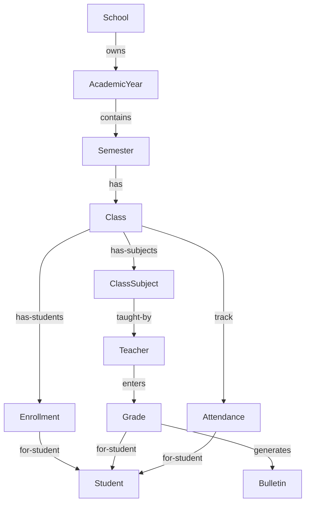

# Module Gestion Scolaire Complète - NeoClass

## Index Rapide

- **Accès Direct**: [API Endpoints](../api/01-API-SPECIFICATIONS.md) | [Database Schema](../database/01-SCHEMA.md) | [UI Components](../ui/01-COMPONENTS.md)
- **Implémentation**: [Backend Setup](01-IMPLEMENTATION-BACKEND.md) | [Frontend Setup](02-IMPLEMENTATION-FRONTEND.md)
- **Tests**: [Test Fixtures](03-TEST-FIXTURES.md)

---

## Vue d'Ensemble du Module

### Objectif
Fournir une gestion académique complète pour les écoles africaines de 50 à 5000 étudiants, avec support offline, synchronisation en temps réel, et rapports automatisés.

### Périmètre

#### 1. Gestion des Élèves (Students)
- ✅ Création avec informations biomé­triques (photo, empreinte)
- ✅ Modification de profil avec historique complet
- ✅ Recherche multi-critères (nom, classe, année)
- ✅ Historique d'activité (entrée/modification/suppression)
- ✅ Export/Import CSV
- ✅ Dédoublonnage automatique par numéro d'identification

#### 2. Gestion des Enseignants
- ✅ Création et gestion des profils
- ✅ Affectation à des classes et matières
- ✅ Suivi des coefficients d'enseignement
- ✅ Calendrier et horaires personnalisés
- ✅ Communications avec les parents (via Communication Module)

#### 3. Gestion des Classes et Structures
- ✅ Création par niveau (CP, CE1, CE2, CM1, CM2, 6e-Terminale, etc.)
- ✅ Sections et groupes de travail
- ✅ Gestion des matières par classe
- ✅ Affectation automatique de capacité (min/max d'élèves)
- ✅ Historique des transferts d'élèves

#### 4. Gestion des Matières
- ✅ CRUD complet des matières
- ✅ Coefficients par matière
- ✅ Contraintes de validation (ex: Maths max 2 diviseurs)
- ✅ Support multilingue (FR, EN, Swahili, Yoruba)

#### 5. Gestion des Notes
- ✅ Saisie flexible (0-20, 0-100, lettres A-F)
- ✅ Calcul automatique des moyennes (simple, pondérée, par compétence)
- ✅ Contrôle de cohérence (validation des extrêmes)
- ✅ Absences impactent les notes (flagging pour révision)
- ✅ Historique complet avec traçabilité (qui, quand, valeur précédente)
- ✅ Support des compétences transversales

#### 6. Bulletins Scolaires
- ✅ Génération automatique PDF (via ReportLab)
- ✅ Paramétrage des sections (notes, appréciations, absences)
- ✅ Templates par niveau/année
- ✅ Signatures numériques (directeur, enseignant)
- ✅ Distribution sécurisée aux parents
- ✅ Historique (bulletins année passée accessible)

#### 7. Gestion des Absences/Présences
- ✅ Appel par classe (rapide: 30sec pour 30 élèves)
- ✅ Justification des absences (document upload)
- ✅ Saisie manuelle multidate (correction)
- ✅ Rapports d'absences par élève/classe/matière
- ✅ Alertes automatiques (> 15% absence → warning)
- ✅ Impact intégré sur bulletins

---

## Principes Architecturaux

### Multi-Tenant Isolation
```
Données strictement isolées par school_id
- Row-Level Security (RLS) PostgreSQL
- Validation au niveau API de chaque request
- Chiffrement optionnel des PII (photos, empreintes)
```

### Performance
```
- Indexation complète sur school_id, class_id, teacher_id
- Caching Redis pour académic_years, classes, subjects
- Pagination systématique (50 items par défaut)
- Lazy-loading pour les relations complexes
```

### Offline-First
```
- Données académiques stockées localement (IndexedDB)
- Appels synchronisés via Service Worker
- Résolution d'conflits (dernière modification gagne)
- Queue d'uploads pour actions offline
```

### Audit Trail
```
- Table audit_logs pour toute création/modification/suppression
- Triggers PostgreSQL pour traçabilité
- 24 mois minimum de rétention
- Récupération complète de versioning
```

---

## Architecture Technique

### Stack Technologique

| Composant | Technologie | Version | Raison |
|-----------|------------|---------|--------|
| **Base de Données** | PostgreSQL | 14+ | Multi-tenant RLS, JSON support, performances |
| **ORM** | Prisma | 4.x | Type-safe, migrations, seed support |
| **API Backend** | Node.js + Express | 18 LTS | JavaScript full-stack, performance, ecosystem |
| **Frontend Web** | Next.js | 14 | React 18, API routes, i18n, offline support |
| **UI Components** | React + Tailwind | Latest | Design System NeoClass compliance |
| **Offline DB** | WatermelonDB | 0.26 | React Native, sync, indexing |
| **PDF** | ReportLab (Python) | 4.x | Qualité bulletins, templating |
| **Real-time** | Socket.io | 4.x | Notifications, sync real-time |
| **Tests** | Jest + Playwright | Latest | E2E et unitaires |

### Structure Microservices

```
Academic Module:
├── Core Service (Port 3002)
│   ├── /students (CRUD élèves)
│   ├── /teachers (CRUD enseignants)
│   ├── /classes (CRUD classes)
│   └── /subjects (CRUD matières)
│
├── Grades Service (Port 3009)
│   ├── /grades (saisis/calcul)
│   ├── /bulletins (génération PDF)
│   └── /competencies (évaluations compétences)
│
└── Attendance Service (Port 3003)
    ├── /attendance (présences/appels)
    ├── /absences (justifications)
    └── /reports (rapports absence)
```

---

## Modèle de Données Conceptuel

### Entités Principales



### Entités de Support

```
- AuditLog: Traçabilité complète
- StudentHistory: Changements élève (photos progressives, etc.)
- ClassTransfers: Mouvements élèves entre classes
- Competencies: Évaluations par compétence transversale
- GradeScale: Configuration 0-20, A-F, etc. par école
```

---

## Phases d'Implémentation

### Phase 1: MVP (Semaines 1-2)

**Fonctionnalités Prioritaires:**
- ✅ CRUD Élèves (import CSV possible)
- ✅ CRUD Enseignants
- ✅ CRUD Classes/Matières
- ✅ Saisie Notes simples (0-20)
- ✅ Appel (présence/absence basique)

**Endpoints API:** 25
**Components React:** 15
**Database Tables:** 12

---

### Phase 2: Complète (Semaines 3-4)

**Nouvelles Fonctionnalités:**
- ✅ Calcul automatique moyennes
- ✅ Bulletins PDF
- ✅ Justification absences
- ✅ Historique élèves
- ✅ Recherche avancée

**Endpoints API:** +20 (45 total)
**Components React:** +12 (27 total)
**Database Tables:** +5 (17 total)

---

### Phase 3: Avancée (Semaines 5-6)

**Features Sophistiquées:**
- ✅ Compétences transversales
- ✅ Alertes automatiques absence
- ✅ Export/Import bulk
- ✅ Rapports analytiques
- ✅ Cache et optimisations

**Endpoints API:** +15 (60 total)
**Components React:** +10 (37 total)

---

## Sécurité

### Authentification
```
- JWT httpOnly cookies
- Refresh tokens (24h expiry)
- 2FA pour administrateurs
- Session tracking (max 3 sessions/user)
```

### Autorisation
```
- RBAC (7 rôles: Super Admin, School Admin, Director, Teacher, Student, Parent, Finance)
- Policy: Professeurs → notes propres classes
- Policy: Élèves → voir propres notes/bulletins
- Policy: Parents → voir enfants uniquement
```

### Données Sensibles
```
- Photos chiffrées à stockage
- Empreintes digitales hashées (Argon2)
- Communications PII loggées
- Suppression GDPR (droit à l'oubli)
```

---

## Performance & Scalabilité

### Benchmarks Attendus

| Opération | Objectif | Contexte |
|-----------|----------|---------|
| Appel classe | < 500ms | 50 élèves |
| Saisie notes | < 300ms | 1 entry |
| Génération PDF | < 2s | Bulletin 30-page |
| Recherche élèves | < 1s | Sur 10k élèves |
| Export CSV 1000 notes | < 5s | Background job |
| Import CSV 500 élèves | < 3s | Background job |

### Indexing Strategy

```sql
-- Primary indices
CREATE INDEX idx_student_school_id ON students(school_id);
CREATE INDEX idx_student_class_id ON students(class_id);
CREATE INDEX idx_enrollment_student ON enrollments(student_id);
CREATE INDEX idx_grade_student_subject ON grades(student_id, subject_id, Academic_year_id);
CREATE INDEX idx_attendance_student_date ON attendance(student_id, Date);
CREATE INDEX idx_class_subject_teacher ON class_subjects(class_id, teacher_id);

-- Composite indices
CREATE INDEX idx_grades_search ON grades(school_id, academic_year_id, student_id) WHERE deleted_at IS NULL;
```

### Caching Strategy

```
Redis Keys:
- academic:year:{schoolId}:{yearId} → 24h
- classes:{schoolId} → 6h
- subjects:{schoolId} → 12h
- teacher:schedule:{teacherId} → 1h
- student:profile:{studentId} → 30min
```

---

## Compliance & Localization

### Localization

```
Traductions: FR, EN, Swahili, Yoruba
- Noms des matières (Math → Mathématiques → Hisabati → Mathimatics)
- Noms des niveaux (CP → Grade 1, etc.)
- Formats de date (DD/MM/YYYY adaptés par région)
- Calendriers scolaires (WESCO, ESCO standards)
```

### Conformité

```
- GDPR: Droit accès, droit oubli, portabilité
- Chiffrement: TLS 1.3, AES-256 au repos (optional)
- Audit: Logs complets 24 mois
- Sauvegarde: Daily snapshots, RPO < 1h, RTO < 30min
```

---

## Prochaines Étapes

1. **Maintenant**: Revue Database Schema
2. **+1h**: Setup API Endpoints et Middleware
3. **+4h**: Build UI Components React
4. **+2h**: Integration Tests
5. **+1h**: Documentation & Deployment Scripts

---

## Fichiers du Module

- 📄 [01-SCHEMA.md](../database/01-SCHEMA.md) - Database complet (Prisma + SQL)
- 📄 [01-API-SPECIFICATIONS.md](../api/01-API-SPECIFICATIONS.md) - API 60+ endpoints
- 📄 [01-COMPONENTS.md](../ui/01-COMPONENTS.md) - React component library
- 📄 [01-IMPLEMENTATION-BACKEND.md](01-IMPLEMENTATION-BACKEND.md) - Backend setup guide
- 📄 [02-IMPLEMENTATION-FRONTEND.md](02-IMPLEMENTATION-FRONTEND.md) - Frontend setup guide
- 📄 [03-TEST-FIXTURES.md](03-TEST-FIXTURES.md) - Test data et seeds
